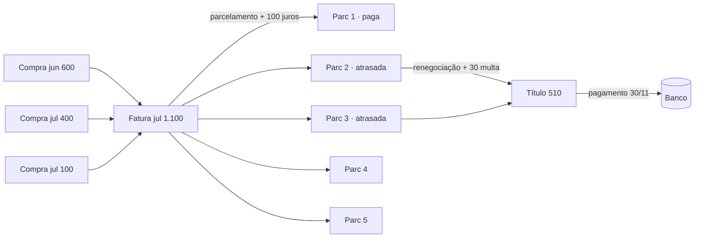

# Salim — Modelo de dados (proposta v2)

DDL completo e testado: `src/salim/schema.sql`. Protótipos: `spike/test_cenario_critico.py` e `spike/test_mais_cenarios.py` (15 testes verdes).

## 1. Ideia central

Cinco tabelas. O que mudou em relação ao plano v1: **sumiram `installment` e `invoice` como tabelas e o `kind` da conta**. Entrou `obligations` (título) como peça única para fatura, boleto, parcela, dívida renegociada e reembolso.

- **Lançamento** (`transactions`) = o que aconteceu e quando. Imutável.
- **Partida** (`postings`) = conta + valor com sinal + **mês de competência** + (opcional) **título**. Imutável. Soma por lançamento = 0.
- **Título** (`obligations`) = "algo a pagar/receber com vencimento". **Não tem valor próprio: o saldo é a soma das partidas que apontam para ele.** Pagar é lançar uma partida contra o título. Parcelar, renegociar e consolidar são lançamentos que zeram títulos antigos e criam novos.
- A competência fica na partida de despesa/receita de origem e nunca é tocada. Por isso nada do que acontece com o título (parcelar, atrasar, renegociar) altera a DRE dos meses originais.

## 1b. Como ler as três tabelas centrais (com o parcelamento real)

| Tabela | O que é | Analogia |
|---|---|---|
| `transactions` | **O fato**: o que aconteceu, quando, descrição | A linha do extrato / o evento |
| `postings` | **As pernas do fato**: cada linha diz "esta conta mexeu tanto, com esta competência". Todas as pernas de um fato somam zero | Débito e crédito do lançamento contábil |
| `obligations` | **A coisa a pagar/receber**: fatura, parcela, boleto, dívida. Tem vencimento. Não guarda valor: o valor é a soma das pernas que apontam para ela | O "título" / a conta a pagar |

`postings` **não é a fatura**. A fatura é uma linha de `obligations`. Cada compra no cartão é uma perna que aumenta a fatura (perna de crédito apontando para ela); a outra perna é a despesa.

**Compra no cartão** (fato #1, 28/06): duas pernas.

| Conta | Valor | Competência | Título |
|---|---|---|---|
| Supermercado | +600,00 | jun/26 | - |
| Cartão Nubank | −600,00 | jun/26 | fatura 2026-07 |

**Parcelamento da fatura em 5x** (fato #4, 04/08). Um fato, sete pernas, cinco títulos novos:

| Conta | Valor | Competência | Título |
|---|---|---|---|
| Cartão Nubank | +1.100,00 | ago/26 | fatura 2026-07 (zera) |
| Juros | +100,00 | ago/26 | - |
| Parcelamentos | −240,00 | ago/26 | parcela 1/5 (vence 05/09) |
| Parcelamentos | −240,00 | ago/26 | parcela 2/5 (vence 05/10) |
| Parcelamentos | −240,00 | ago/26 | parcela 3/5 (vence 05/11) |
| Parcelamentos | −240,00 | ago/26 | parcela 4/5 (vence 05/12) |
| Parcelamentos | −240,00 | ago/26 | parcela 5/5 (vence 05/01) |

Soma = 0. A fatura fica com saldo zero, nascem 5 parcelas com saldo 240 e vencimentos próprios, e as compras de junho e julho continuam com a competência delas, porque aquelas pernas nunca foram tocadas.

## 2. Tabelas

| Tabela | Papel | Colunas que carregam o modelo |
|---|---|---|
| `accounts` | Plano de contas | `type`, `parent_id`, `is_group`, **`is_cash`** (entra no fluxo de caixa), **`tracks_obligations`** (toda partida exige título), `is_temporary`, `closing_day`/`due_day` (só cartão) |
| `transactions` | Fato | `event_date`, `kind`, `reverses_id`, `external_ref` (idempotência para Telegram/Open Finance) |
| `postings` | Partida | `amount_cents` (débito +, crédito −), **`competence_month`** (sempre dia 01), `obligation_id` |
| `obligations` | Título | **`due_date`** (vencimento), `closing_date` (fatura), **`planned_date`** (quando eu planejo pagar), `kind`, `created_by_tx_id` (agrupa as parcelas de um plano) |
| `budget_lines` | Orçamento | `account_id`, `month` (NULL = mês padrão), `amount_cents`, `profile` (`lump` no dia X / `spread` diluído) |

## 3. Regras garantidas no banco (não só no app)

1. Conta-grupo não recebe partida.
2. Conta com `tracks_obligations` exige `obligation_id`; o título tem que ser da mesma conta. **Consequência: saldo da conta = soma dos saldos dos títulos.**
3. `transactions` e `postings` não sofrem UPDATE nem DELETE (estorno é novo lançamento).
4. Título: conta, origem e tipo imutáveis; só `due_date`, `planned_date` e `reference` mudam. Não se apaga.
5. Competência é sempre dia 01.

**Não garantido no banco:** soma do lançamento = 0. SQLite não tem constraint diferida; o serviço valida e o teste de balancete cobre. No Postgres dá para virar constraint trigger diferida.

## 4. Requisito → como sai

| Você pediu | Como sai |
|---|---|
| Em atraso / em dia / a vencer | Título com saldo > 0: `due_date < hoje` = atrasado (e há quantos dias); senão a vencer. Saldo 0 = quitado. Fatura com `closing_date ≥ hoje` = aberta |
| Data de pagamento | `event_date` do lançamento que debitou o título |
| DRE por competência, incluindo não pago | Soma de partidas de receita/despesa por `competence_month` (view `v_dre`) |
| Fluxo de caixa executado | Movimento das contas `is_cash` por `event_date` (view `v_cash_executed`) |
| Fluxo de caixa futuro | Títulos com saldo na data `COALESCE(planned_date, due_date)` (view `v_cash_future`); orçamento cobre o que ainda não virou título |
| Orçado × realizado | `budget_lines` × soma de partidas da conta (e filhas) por `competence_month` |
| Cenário "o que eu devo e por quê" | Linhagem: o lançamento que criou o título aponta para os títulos que ele quitou, até as compras |

## 5. Cenário crítico, resultado real do protótipo (hoje = 19/11/2026)

Fatura de cartão (fecha dia 25, vence dia 5) com compras de **junho** (R$ 600) e **julho** (R$ 500) → parcelada em 5x de R$ 240 (R$ 100 de juros) → parcela 1 paga em dia → parcelas 2 e 3 atrasam → renegociadas em 1 título de R$ 510 (R$ 30 de multa) → liquidado em 30/11.

| Verificação | Resultado |
|---|---|
| Aging em 18/11 | parcela 2: atrasada 44 dias; parcela 3: atrasada 13 dias; 4 e 5: a vencer |
| DRE por competência | jun 600 · jul 500 · ago 100 (juros) · nov 30 (multa, linha própria). **jun e jul idênticos antes e depois da renegociação** |
| Caixa executado | set −240 · nov −510 |
| Caixa futuro | 05/12 −240 · 05/01/27 −240 (mover `planned_date` muda a projeção sem mexer no vencimento) |
| Origem dos R$ 510 renegociados | mercado 240 · restaurantes 160 · assinaturas 40 · juros 40 · multa 30 |
| Banco barra | partida sem título em conta de cartão, título de outra conta, UPDATE/DELETE, competência fora do dia 01 |

## 6. O que está provado e o que não está

**Provado no protótipo:** tudo da seção 5.

**Provado em `test_mais_cenarios.py`:**
- compra parcelada no cartão (3x): despesa inteira na competência da compra, caixa em 3 faturas;
- 3 contas de luz atrasadas pagas numa saída só, com competências de ago/set/out preservadas e multa e juros em linhas separadas;
- reembolso a receber (jantar dividido com o João): só a minha metade é despesa, a dele vira título a receber, com atraso e recebimento;
- pagamento parcial de fatura: sobra saldo e ele atrasa;
- estorno de pagamento: o título reabre e volta a atrasar;
- orçamento × realizado, com perfil pontual (aluguel no dia 5) e diluído (mercado).

**Cabe no modelo, ainda não testado:** perdão de dívida, desconto por antecipação, financiamento com juros embutidos, despesa anual rateada por competência, rotativo com juros.

**Pontos fracos que eu vejo:**
1. Mudar `due_date` de um título não deixa histórico. Aceito na v1; tabela de auditoria depois.
2. Fluxo de caixa **por categoria** exige recursão pela linhagem (provada em Python, falta a versão SQL). Decisão: o caixa mostra "pagamento da fatura/parcela X"; a composição por categoria é detalhe opcional, repartida proporcionalmente.
6. Consultas "como estava em data passada" (aging histórico) precisam filtrar por `event_date`; as views de hoje não filtram.
3. Juros de mora automáticos não existem; é lançamento manual.
4. Moeda única (BRL).
5. A coluna `competence_month` existe também em partidas de balanço (banco, cartão), onde não significa nada. Uniforme e inofensivo, só ruído.

## 7. O que muda no que já foi construído

| Item | Mudança |
|---|---|
| E1 (30 testes verdes) | `Account.kind` sai; entram `is_cash`, `tracks_obligations`, `closing_day`, `due_day`. `competence_date` vira `competence_month` (dia 01). `Posting` ganha `obligation_id`. Triggers de imutabilidade no banco além dos eventos do ORM. Os testes existentes continuam como estão, salvo o de competência |
| E3 (Faturas) e E4 (Obrigações) | Fundem-se: título é a peça única. Histórias de `invoice` e `installment` somem; entram "criar título", "pagar título", "fatura abre sozinha na primeira compra", "parcelar", "consolidar" |
| E5 | Orçamento passa a usar `competence_month` e `budget_lines` como acima |

## 8. Decisões (resolvidas em 19/11)

1. **Gestão por competência, não por caixa.** Compra parcelada no cartão entra **inteira** na competência do mês da compra; o caixa sai nas faturas.
2. **Competência é mês**, para confrontar com o orçamento mensal.
3. **Juros e multa** em contas (linhas) separadas: `5.07.01 Juros` e `5.07.02 Multas`.
4. **Fluxo de caixa** mostra o pagamento do título. Abrir por categoria é detalhe proporcional, fora da v1.

## Fila de importação (E8)
`import_items`: item de extrato (CSV ou conector) que ainda não virou lançamento. `external_id` único impede reimportar; `status` pending → matched (casou com lançamento existente) | booked (virou lançamento) | ignored. Não faz parte do razão: só vira partida dobrada quando alguém trata o item.
