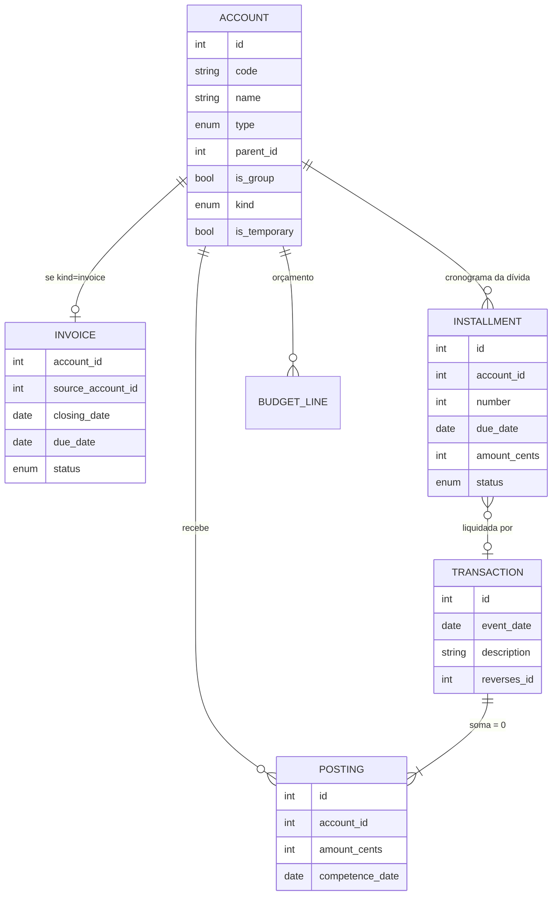

# Salim — Plano

> Nome temporário. Controle financeiro pessoal/familiar sobre um ledger de partidas dobradas, com faturas, parcelas, competência, orçamento, Telegram e MCP.

## 1. Premissas (corrija se alguma estiver errada)

| # | Premissa | Por quê |
|---|----------|---------|
| P1 | Python 3.13 + FastAPI + SQLAlchemy 2 + SQLite (Postgres depois) + pytest | Stack onde a IA erra menos. Trocar para Go/Rust depois é reescrita do núcleo, e o contrato é o conjunto de testes |
| P2 | Dinheiro = inteiro em centavos, BRL único | Sem float. Multi-moeda fica fora da v1 |
| P3 | Um banco SQLite por família ("livro") | Isolamento sem `book_id` em toda tabela. Multi-tenant real entra com Postgres |
| P4 | Débito = positivo, crédito = negativo; soma das partidas de um lançamento = 0 | Invariante central, testada em toda entrega |
| P5 | Lançamento é imutável; correção = estorno + novo lançamento | Auditoria e reconciliação confiáveis |
| P6 | UI web server-rendered (Jinja + HTMX) | Poucos arquivos por história; sem build de front |
| P7 | "Raio de explosão" = no máximo 2 arquivos de produção por história (1 back + 1 front, ou 2 back), mais o arquivo de teste | Interpretação do pedido |
| P8 | Teste integrado = banco SQLite real em memória + FastAPI TestClient, sem mocks do ledger | Mocks escondem erro de contabilidade |

## 2. Modelo (o motor)

**Ideias-chave**

- **Conta** tem tipo (ativo, passivo, receita, despesa, patrimônio), pai (grupos) e `kind`: `normal`, `invoice`, `obligation`. Contas temporárias (transição, reembolso, dívida com PJ) são contas normais com `is_temporary`.
- **Lançamento** tem data do evento. **Partida** tem conta, valor com sinal e **data de competência própria**. Por isso um pagamento pode carregar várias competências.
- **Fatura** é uma conta de passivo que acumula saldo, com fechamento e vencimento. Pagar = lançamento débito na fatura / crédito no caixa. Saldo zera, nasce a próxima.
- **Obrigação** é uma conta de passivo com cronograma de **parcelas** (`installment`), cada uma com vencimento próprio, independente da data do evento.
- **Consolidação** = lançamento que debita N obrigações/faturas e credita uma nova obrigação, com seu próprio cronograma. A competência fica nas partidas de origem (despesa) e não se perde.
- **Fatura é um caso de obrigação**: uma parcela única que cresce até o fechamento. Parcelar fatura = trocar por N parcelas.
- **Orçamento** é só leitura sobre o ledger: `orçado (mês padrão + perfil de gasto) × realizado (soma de partidas por competência)`.

## 3. Entregas

| Entrega | Resultado verificável | Depende de |
|---------|----------------------|-----------|
| **E0 Fundação** | App sobe, `pytest` verde, banco migrável | — |
| **E1 Ledger** | Contas, plano padrão, lançamento de partida dobrada, saldos, estorno, balancete = 0 | E0 |
| **E2 Interface web** | Plano de contas, novo lançamento, extrato e saldos no navegador. **Primeiro uso real, sem IA e sem orçamento** | E1 |
| **E3 Faturas** | Cartão/guia como conta com fechamento, vencimento, liquidação e fatura seguinte | E1 |
| **E4 Obrigações e parcelas** | Compra parcelada, vencimento ≠ evento, consolidação de dívidas, múltiplas competências | E3 |
| **E5 Orçamento** | Mês padrão, orçado × realizado, perfil de gasto (aluguel no dia 5 vs mercado diluído), alerta simples | E2 |
| **E6 API de consulta + MCP** | Ferramentas MCP: saldo, extrato, orçamento, faturas a vencer | E3, E5 |
| **E7 Telegram** | Bot responde consultas e executa lançamentos com confirmação | E6 |
| **E8 IA no lançamento** | Texto livre → lançamento proposto → confirmação | E7 |
| **E9 Open Finance** | Importação de extratos e conciliação com lançamentos | E2 |
| **E10 WhatsApp** | Mesmo módulo de comunicação, novo canal | E7 |

Ordem de execução: E0 → E1 → E2 → E3 → E4 → E5 → E6 → E7 → E8 → E9 → E10. A partir da E2 já dá para usar.

## 4. Regra de trabalho (toda história)

1. Escrever o(s) teste(s) de aceite e vê-lo(s) **falhar** pelo motivo certo.
2. Menor mudança que passa.
3. Rodar a suíte inteira. Verde → próxima. Vermelho → corrige antes de seguir.
4. Invariante global verificada em todo teste de ledger: soma de todas as partidas = 0.
